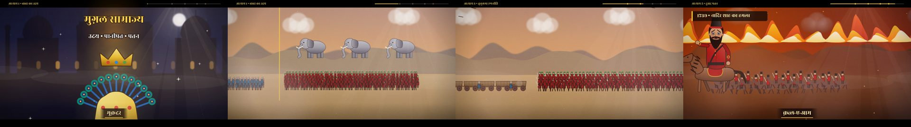

# claude_with_animation 🎬

**Claude ke saath free mein 2D animated history/story videos banao** — characters, fauj, top, haathi, naqshe, chapter cards, keyword captions, sound effects, Reels aur Quiz, sab code se. Koi paid video generator nahi.

> Make free 2D animated story videos with Claude: code-drawn characters, armies, maps, motion graphics, synced to your narration — plus 9:16 Reels, quiz Shorts and thumbnails.

Built for the YouTube channel **कथा और रहस्य** ([@kathaaurrahasya](https://www.youtube.com/@kathaaurrahasya)). Example included: *मुग़ल साम्राज्य — उदय, पानीपत और पतन* (9:53, 40 animated beats).



## Kya milta hai / What's inside

| Part | File | Kya karta hai |
|---|---|---|
| 2D engine | `cwa/engine.py`, `cwa/mengine.py` | skia-python se characters (pagdi, dadhi, robe, lip-sync), ghode, fauj, top, gaadi, jhande, takht, naqsha (animated route, failta/simatta saamrajya), backgrounds |
| Long video | `cwa/render_long.py` | Narration ke saath 3–5 sec mein shot-cuts, camera moves, parallax + depth blur, dhundh, roshni, dhuan, keyword captions, chapter tracker, wipes, SFX + music mix, 1080p render |
| Reels | `cwa/reels.py` | Final video se 9:16 Reels, hook text ke saath |
| Quiz | `cwa/quiz.py`, `cwa/tts.py` | 9:16 quiz Short, 5-sec timer, cloned narrator voice (Chatterbox, optional) |
| Thumbnails | `cwa/upscale.py`, `cwa/thumbs_16x9.py` | Real-ESRGAN 4x upscale + 16:9 Hindi thumbnail |
| Helpers | `tools/transcribe.py`, `tools/make_sfx.py` | Word timestamps (faster-whisper), ElevenLabs SFX (optional) |
| Example | `examples/mughal_panipat/` | 40-beat scene file, quiz, reels, thumbnail text, Animate cut-paper hook |

## Install (Mac / Linux)

```bash
git clone https://github.com/Manojkapri29/claude_with_animation
cd claude_with_animation
./setup.sh            # Python venv + packages (needs python3, ffmpeg)
. .venv/bin/activate
```

## Claude se video banwao (sabse aasaan)

Folder ko **Claude Code** (terminal ya VS Code extension) mein kholo aur bolo:

> "Meri narration `projects/shivaji/src/voice.wav` hai. Isse animated video banao, 3 reels aur 2 quiz bhi."

Claude `CLAUDE.md` aur `.claude/skills/animated-history-video/SKILL.md` padh kar poora workflow chalayega.

## Haath se (manual)

```bash
cp -r examples/mughal_panipat projects/my_video      # new project
# 1) apni narration wav(s) projects/my_video/src/ mein rakho
# 2) projects/my_video/scenes.py mein SEGMENTS aur BEATS likho
export CWA_PROJECT=projects/my_video
python tools/transcribe.py                    # captions + cut points
python cwa/render_long.py frames 10,60,120    # contact sheet preview -> out/sheet.jpg
python tools/make_sfx.py                      # optional, needs ELEVENLABS_API_KEY
python cwa/render_long.py full                # final 1080p -> out/final_raw.mp4
CWA_FINAL=projects/my_video/out/final_raw.mp4 python cwa/reels.py
python cwa/tts.py && python cwa/quiz.py 0     # quiz voice + quiz video
```

Example chalane ke liye apni narration audio `examples/mughal_panipat/src/mughal.wav` aur `panipat.wav` naam se rakho (audio repo mein nahi hai).

## Rules / Zaroori baatein

- **Voice clone sirf apni aawaz ya ijazat wali aawaz ka.** `voice_ref.wav` git mein mat daalo.
- **API keys kabhi commit mat karo** — `ELEVENLABS_API_KEY` environment variable mein rakho.
- Facts check karo: narration ki galti (jaise saal) screen aur description mein theek karo.
- Generated SFX/music ka license us service ki terms par depend karta hai.

## Credits

Engine, scenes aur pipeline: Claude (Anthropic) ke saath banaya gaya. Optional tools jo iske saath kaam aate hain: [Chatterbox TTS](https://github.com/resemble-ai/chatterbox), [faster-whisper](https://github.com/SYSTRAN/faster-whisper), [Real-ESRGAN](https://github.com/xinntao/Real-ESRGAN), [Animate skill](https://github.com/cth9191/animate) (hook), [OpenMontage](https://github.com/calesthio/OpenMontage) (color grade), [auto-editor](https://github.com/WyattBlue/auto-editor). Fonts: Google Fonts (OFL).

License: MIT (code). Fonts: SIL OFL 1.1.
